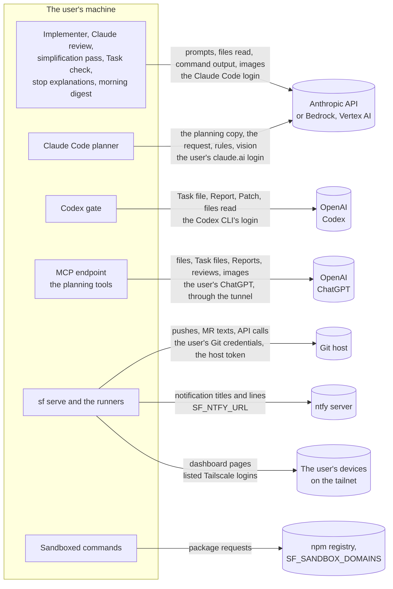

# Data flows: what leaves the machine

The factory runs on the user's machine, but its agents are remote models. The rule to remember:
**whatever an agent reads goes into its model provider's context.** That is the Implementer's
prompt and every file it opens and every command output it sees, the reviewers' Patch and the
files they read, the planner's tool results. This page lists every flow out of the machine, to
whom and under which account, then what that means for confidential client data. The mechanisms
that keep secrets in are on the [Security](security.md) page.

## The flows

| Flow | What leaves | To | Under which account | Code |
| --- | --- | --- | --- | --- |
| Implementer turns | The prompts (the command naming the Task file, the `<rules>` block of coding rules, the factory's rules, the images, the user's messages), every file the Implementer reads (the Task file first), every command's output | Anthropic's API, or Amazon Bedrock or Google Vertex AI when Claude Code runs on them (`CLAUDE_CODE_USE_BEDROCK`, `CLAUDE_CODE_USE_VERTEX`) | The Claude Code login of the machine, or the cloud account Claude Code runs on | `src/session.ts` |
| Claude review, simplification pass | The factory's copy of the Task file, the Report, the Patch (inline up to a size, the rest read in the worktree), the rules, the ledger, the files they read | as above | as above | `src/review.ts`, `src/simplify.ts` |
| Task check | The Task file and its images, the Task files it builds on, the rules, the files it reads in its checkout of the base | as above | as above | `src/task-check.ts` |
| Stop explanations | The Task's goal, the stop's message, its ledger entries, the last Report, the user's messages | as above | as above | `src/explain.ts` |
| Morning digest | The Git data of the followed workspaces (what landed, live branches, commit messages) and their descriptions | as above | as above | `src/digest-run.ts` |
| Codex gate | The Task file, the Report, the Patch, the review rules and method; whatever Codex reads in the worktree | OpenAI | The Codex CLI's own login (`codex login`, the user's ChatGPT plan) | `src/gate.ts` |
| ChatGPT planner | The Handbook; files from `read_file` and `search` (tracked and untracked, never Git-ignored or credential-like); images from `read_attachment`; from `read_job` a job's state, one Report (up to 64 KiB) and the reviews' items, real paths replaced; the queue | OpenAI, through the tunnel client's outbound connection | The user's ChatGPT account; the tunnel is registered in the user's OpenAI organisation | `src/server.ts`, `src/repo-files.ts`, `src/planner.ts` |
| The prefilled ChatGPT links | The first message of a planning conversation (the ticket, the workspace, the user's words), or of Discuss the result, in a `chatgpt.com` link, when the user opens it | OpenAI | The user's ChatGPT account | `src/conversation.ts` |
| Claude Code planner | Its planning copy (a clone of `origin`), the user's request, the rules files, the vision's English files, the prototypes it writes, whatever else it reads; Remote Control makes the session reachable from the user's Claude account | Anthropic | The user's claude.ai login | `src/planning-copy.ts`, `src/planner-session.ts` |
| Git host | The pushed commit (the change and the MR text as its message), the branch name; the merge request's title and description; the API requests for its status, its review comments and the merge | The workspace's `origin`; `api.github.com`, `gitlab.com` or `SF_GITLAB_URL` | The user's Git credentials for the push; `SF_GITHUB_TOKEN` or `SF_GITLAB_TOKEN` for the API | `src/mr.ts`, `src/forge.ts` |
| Phone notifications | The title (the ticket and its state) and up to three lines (such as the branch or the stop's code and message); a `brief` workspace sends one line instead | The ntfy server of `SF_NTFY_URL` | The topic in that URL, and `SF_NTFY_TOKEN` when set | `src/notify.ts` |
| Sandboxed commands | Whatever a command sends to an allowed host (package installs, above all) | `registry.npmjs.org` and `SF_SANDBOX_DOMAINS` | none of the user's: `~/.npmrc` is denied | `sandboxSettings`, `src/config.ts` |
| Remote dashboard | The dashboard's pages | The user's own devices, through `tailscale serve` | The Tailscale logins in `SF_DASHBOARD_REMOTE_LOGINS` | `src/dashboard.ts` |

These are the flows the factory starts or serves. Its records (the job directories, the Task
checks' results, the pins, the vision) stay in the state directory, and desktop notifications and
the loopback dashboard stay on the machine. The two CLIs the factory runs, Claude Code and Codex,
are the providers' own programs; what they do beyond the prompts the factory gives them is theirs.

## Confidential client data

Take a product repository, `product-frontend`, whose test fixtures hold a client's confidential
ontology. Plainly: **once that repository is a workspace, any part of it an agent reads goes to
that agent's provider.** The Implementer reads what its task needs and anything else in its
worktree or the workspace's checkout it decides to open; the reviewers read the Patch and the
files around it; a fixture the change touches is in the Patch. With the default settings that is
Anthropic (the Implementer, the Task check, the explanations) and OpenAI (the Codex gate, and
ChatGPT when it plans). Beyond the models: Reports and reviews that quote the code go to the
planner's provider when it calls `read_job`, notification lines to the ntfy server, and the pushed
commit to the Git host.

### What the factory enforces

| Lever | What it does | What it does not do |
| --- | --- | --- |
| The sandbox's scope | A job reaches its own worktree and its workspace's checkout; the other workspaces' checkouts, the other jobs, the home directory but the toolchains, and every credential are denied to every job session and the Task check ([Security](security.md#what-no-session-can-reach)) | It does not narrow what a session may read inside its own workspace: Git-ignored files in the checkout are readable too; only `.env` files are denied |
| The planner's file tools | `read_file` and `search` refuse Git-ignored and credential-like files, links resolved | They read every tracked and untracked file that is not ignored |
| The guard on pushes | Refuses secrets in what the factory publishes, everywhere; in a workspace with `"guard": true`, also the names of the user's other workspaces and the terms of `guard-terms.txt` | It reads what is published to the Git host, not what reaches a model provider |
| `notify` per workspace | `brief`: ntfy gets the title, the priority and one line (the workspace's name, an error's code), no branch, path, message, MR title or link; `off`: nothing on either channel (`src/notify.ts`) | `brief` still sends the title, which names the ticket and its state; the health, usage limit and digest notifications ignore the setting |
| The morning digest | Reads only the workspaces its `digest` setting follows (`track`, `my_work`) | |
| The Patch | Leaves out ignored and credential-like paths (`src/patch.ts`) | A fixture the change adds or edits is in it |

### What is up to the user

- **Keep such data out of the workspaces.** In the home directory, a job's sessions and the Task
  check reach only their workspace's checkout and the toolchain folders, and the ChatGPT planner
  only the checkout's files that Git does not ignore. Inside the checkout even a Git-ignored file
  is readable to a job's sessions, and outside the home directory they read what any local user
  may read. The Claude Code planner's settings deny it only the secret files, and the coordinator
  is the user's own session: the factory does not hold either from the rest of the home
  directory.
- **Synthetic fixtures.** Tests built on generated data with the real shape give the agents what
  they need without the content; keep real samples outside the workspace.
- **Rules per workspace.** `rules/<workspace>.md` in the config directory (and the repository's
  `AGENTS.md`) reach the Implementer, the reviewers and the Task check
  ([Configuration: coding rules](../guide/configuration.md#coding-rules)): name the folders not to
  open or quote. These are instructions a model follows, not a denial.
- **Choose who sees what.** The models are factory-wide settings, not per workspace. `SF_GATE=off`
  keeps the reviews with Anthropic, at the price of the second vendor's review; a Task file
  written by hand, or by a Claude Code planner, sends no planning reads to OpenAI.
- **Choose the provider accounts.** Use plans or settings whose terms fit the data (whether
  inputs may be used for training, how long they are kept): check your account's terms. The
  factory cannot see or enforce them.
- **Leave the merge request to yourself.** The default hand-over puts the change in your checkout;
  nothing reaches the Git host until you push it.

### What the factory does not offer

No per-path read denial inside a workspace beyond `.env` files, no scan or redaction of the code
and data an agent reads before it is sent, no per-workspace choice of model or provider, and no
guarantee that an agent opens only the files its task needs.

Next: [Testing](testing.md).
