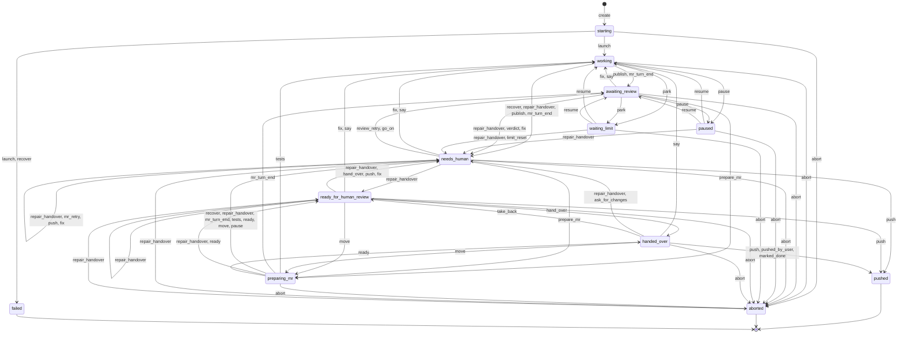

# Job lifecycle

A job is one ticket being implemented on one branch. Its state is one of twelve, and every change
of state is a row of one table, `JOB_TRANSITIONS` in `factory/src/jobs.ts`: the transition seam
(`transition`, `src/execution/core.ts`) checks each change against it before it is written, and
refuses any other with `illegal_transition` (`checkTransition`). The reference prints the table
([Job states](../../factory/README.md#job-states)) and `factory/test/transitions.test.ts` keeps the
two the same. The user's view of the states, with their buttons and commands, is in
[Concepts: the job states](../guide/concepts.md#the-job-states).

## The states

| State | What it means | Counts against `max_running` | Waits for the user | Board column |
| --- | --- | --- | --- | --- |
| `starting` | The record exists; the factory fetches the base, creates the worktree and the branch and queues the first turn | yes | | Implementing |
| `working` | The Implementer runs a turn: the task, a Fix section, the user's message, the MR text or a conflict resolution | yes | | Implementing |
| `awaiting_review` | An iteration is published; its review round (or the simplification pass) runs | yes | | Reviewing |
| `preparing_mr` | MR preparation: the test command, the MR text turn, the commit and the rebase | yes | | Reviewing |
| `waiting_limit` | A session hit the plan's usage limit; parked until the reset, holding its slot | yes | | Implementing |
| `needs_human` | Stopped for the user, with a code | | yes | Your turn |
| `paused` | The user paused it; nothing runs, everything is kept | | | Your turn |
| `ready_for_human_review` | Clean, MR text written, one commit on the branch; not handed over | | yes | Your turn |
| `handed_over` | The branch is checked out in the user's checkout, the changes uncommitted | | yes | Your turn |
| `pushed` | Done: the branch is on `origin` (or the user marked it merged). Terminal | | | Done |
| `aborted` | Ended by the user; the branch stays. Terminal | | | Done, or the ticket back in Queue |
| `failed` | Could not start. Terminal | | | Done, or the ticket back in Queue |

The two middle columns come from each state's traits (`STATE_TRAITS`, `src/jobs.ts`): `running`
(`RUNNING_STATES`, what the run queue's limit counts) and `waiting`; a `terminal` state (the last
three) lets a new job of the ticket start. The board's columns are the guide's
([Concepts](../guide/concepts.md#the-job-states)). Other traits say which commands a state takes
(`pausable`, `resumable`, `sayable`, `restartable`), which states notify the user (`notified`) and
which a sandboxed session may run in (`sandboxed`).

## The state machine

Every arrow below is one or more rows of `JOB_TRANSITIONS` at the time of writing (79 rows, 51
arrows), labelled with the actions that make it; the generator is at the end of this page.



`repair_handover` and `recover` belong to `sf serve`'s start (below); the user never triggers them.
The self-arrows are stops that stay stops: a failed push of a stopped job, a Retry of MR
preparation that fails again before it began, a Fix refused at a limit.

## Who moves a job

Each action is a step of `src/execution/`; every `needs_human` stop of one step shares its action
(`JOB_ACTIONS`, `src/jobs.ts`).

| Action | The step | Started by |
| --- | --- | --- |
| `create`, `launch` | The start: the job record, then the fetch, the worktree and the first turn (or `failed`) | the user's Start, or the run queue |
| `publish` | The end of an Implementer turn: the iteration is published, or the turn stopped | the runner |
| `verdict` | A review round whose outcome stops the job (a dispute, churn, the gate's budget, a failed review, …) | the runner |
| `fix` | A Fix section starts the next turn, or is refused at a limit (`iteration_limit`) or by the guard | the runner, or the user's settlement |
| `prepare_mr` | Clean starts MR preparation, or the user's Accept, Skip or Retry does | the runner, the user |
| `tests` | The end of the test command's run: a Tests fix, or a stop | the runner |
| `mr_turn_end` | The end of the MR text turn or of the conflict turn: back to review, or a stop | the runner |
| `ready` | The end of MR preparation: handed over, ready to push, or a stop | the runner |
| `move` | A part moved onto its base once the ticket it builds on is merged, or its stop | `sf serve` |
| `review_retry`, `go_on`, `mr_retry` | Retry of a failed review; the round again after a settled ledger stop; a Retry of MR preparation that fails again before it began | the user |
| `say` | The user's message starts a turn (on a handed-over job: Ask for changes) | the user |
| `pause`, `resume`, `abort` | | the user (`resume` also the run queue after a usage limit) |
| `park`, `limit_reset` | A session hit the usage limit; a resume at the limit's reset that failed | the runner; the run queue |
| `hand_over`, `take_back`, `ask_for_changes` | Hand over to my checkout and Take it back; an Ask for changes that was cut off | the user (`sf serve` retries a hand-over refused by another job's config lock) |
| `push`, `pushed_by_user`, `marked_done` | Approve or Create merge request; the user's own push of a handed-over branch; Merged — archive | the user (`sf serve`'s pass of merged jobs for `marked_done`) |
| `recover`, `repair_handover` | `sf serve` at its start with a job whose runner is gone; the repair of a cut-off hand-over | `sf serve` |

## Stops

A job that needs a person goes to `needs_human` with a code. The stops table (`src/stops.ts`) has
one row per code, 11 decisions and 20 errors: its kind, its aliases, whether the user settles
ledger entries there, and its actions in order, each shown only while its precondition holds. The
dashboard renders what that table says and decides no rule of its own. For each stop but a usage
limit, a model session with no tools writes a plain explanation with the choices and a
recommendation (`src/explain.ts`); it never acts. Every code and what to do:
[When a job stops](../guide/when-a-job-stops.md).

## The brakes of the review loop

| Brake | Default | What it counts | Stop |
| --- | --- | --- | --- |
| `SF_MAX_ITERATIONS` | 3 | Review rounds without progress: a round that asks for a Fix while no fewer blocker and major findings are open than after any earlier such round, or that reopens a fixed or left one (the first round with a Fix only sets the low) | `iteration_limit` |
| `SF_GATE_MAX_ROUNDS` | 5 | The gate's fix rounds without progress, on a job with the Claude review | `gate_rounds` |
| `SF_GATE_MAX_TOKENS` | 5,000,000 | The gate's tokens, for every started 2,000 changed lines of the job's change | `gate_budget` |
| The ledger | | A contest reopened, a fix reopened twice, a round whose every blocking item came from earlier fixes, an escalation | `review_disputed`, `review_churn`, `escalated` |
| `SF_MAX_TURNS` | | Steps of one Implementer turn; a turn that hits it while it still changes files goes on by itself (`src/turn-limit.ts`) | `max_turns` |

A ticket marked `important: true` is not stopped by the first three; the ledger, the turn limit,
failing tests, failures, usage limits and the user still stop it. The user's message at a limit
stop starts the counts again ([ADR 0005](../adr/0005-api-reviewers-and-factory-git.md),
amendments SF-292 to SF-297).

## Processes and crash safety

- **One runner per job** (`src/runner.ts`), guarded by a pid lock that also records the owner's
  start time, so a reused pid is not taken for the owner (`src/pid-lock.ts`). `sf serve` asks it
  for things only through files (a request in the job's `queue/`, the answer in `replies/`) and
  stops it with `SIGTERM`. A restart of `sf serve` leaves it running.
- **One seam, two locks.** Every state change after the first goes through `transition`
  (`src/execution/core.ts`), which checks the table and notifies; an operation lock serialises the
  lifecycle's steps and a per-workspace Git lock serialises Git.
- **`sf serve`'s start** (`recover`, `src/execution/start.ts`) looks at every job whose runner is
  gone: `working` becomes `needs_human` (`serve_restarted`), `preparing_mr` becomes `needs_human`
  (`mr_serve_restarted`), `starting` becomes `failed`, and a job in `awaiting_review` gets a new
  runner, which resumes its round. A hand-over step that was cut off is repaired first
  (`repair_handover`).
- **Pause and usage limits** throw the interrupted review round away, never a verdict; Resume runs
  it again, or continues the same Implementer session (`src/execution/control.ts`,
  `src/usage-limit.ts`).
- **Updates drain first** (`src/update.ts`): `sf update` pauses the working and reviewing jobs,
  waits until nothing runs, builds and typechecks; a failure rolls the install back and resumes the
  jobs on the old code. The state's format is versioned (`src/state-version.ts`).
- **Leftovers are reaped.** Sandbox processes left behind by a finished session are ended
  (`src/sandbox-reaper.ts`), and the health checks restart what can be restarted
  (`src/recovery.ts`).

## Trade-offs

- **A lost runner is not always resumed.** A job whose runner died while it was `working` or
  `preparing_mr` stops for the user (`serve_restarted`, `mr_serve_restarted`); only a job in
  `awaiting_review` goes on by itself.
- **An interrupted review round is paid twice.** Pause, a usage limit and an update throw the
  running round away and run it again.
- **A usage limit holds the queue.** A parked job keeps its slot, and while any job waits for
  limits the queue starts nothing ([CONTEXT.md](../../CONTEXT.md)).
- **The brakes need a person.** Every limit ends in a stop the user answers; a ticket marked
  `important: true` trades the three loop limits for the risk of using up the plan's allowance.
- **This page's diagram is generated, not pinned.** The test pins the reference's table, not this
  diagram: regenerate it when `JOB_TRANSITIONS` changes.

## Regenerating the diagram

After `npm run build`, this command, run in `factory/`, prints the diagram above from the code
(without its blank lines):

```sh
node --input-type=module -e '
const { JOB_TRANSITIONS: t, JOB_STATES: s, JOB_ACTIONS: a, TERMINAL_STATES: end } = await import("./dist/src/jobs.js");
const o = (x) => (x === null ? -1 : s.indexOf(x)), e = new Map();
for (const r of t) { const k = `${r.from}|${r.to}`; e.set(k, [...(e.get(k) ?? []), r.action]); }
console.log("stateDiagram-v2");
for (const [k, acts] of [...e].sort(([x], [y]) => { const [xf, xt] = x.split("|"), [yf, yt] = y.split("|"); return o(xf === "null" ? null : xf) - o(yf === "null" ? null : yf) || o(xt) - o(yt); })) {
  const [f, to] = k.split("|");
  console.log(`    ${f === "null" ? "[*]" : f} --> ${to}: ${[...new Set(acts)].sort((x, y) => a.indexOf(x) - a.indexOf(y)).join(", ")}`);
}
for (const x of end) console.log(`    ${x} --> [*]`);'
```

Next: [Security](security.md).
