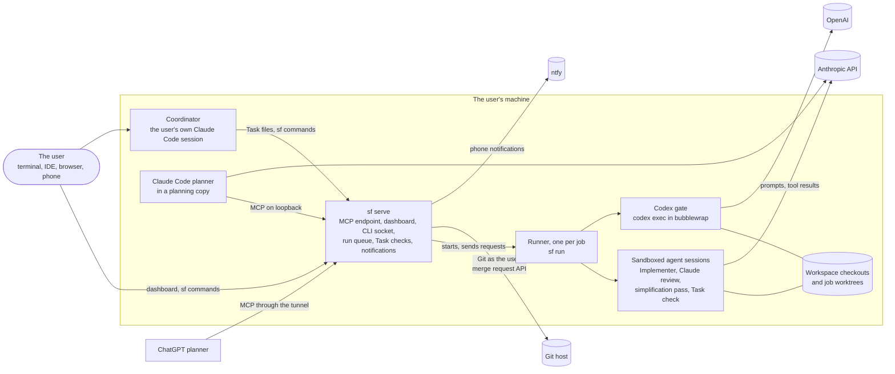
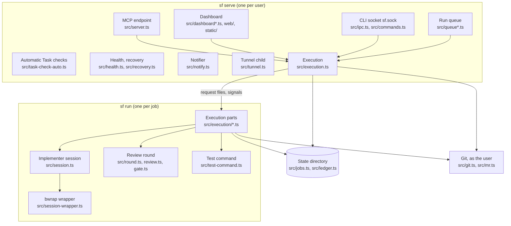

# Overview: the system and its parts

The factory is a local tool for one person on one Linux machine. It takes a planned ticket through
Claude Code headless, has every iteration reviewed, turns the findings into fix rounds by itself,
and does the Git work itself, so that nobody has to watch a terminal between Start and their own
review. This page is the map: who takes part, which processes run, where the state lives and which
module does what. The vocabulary is [CONTEXT.md](../../CONTEXT.md); the guide's
[Concepts](../guide/concepts.md) walks through the same process from the user's side.

## The system in context

Everything inside the box runs as the user. The arrows that leave it are the subject of
[Data flows](data-flows.md); the boundaries inside it are the subject of [Security](security.md).

## Who takes part

| Role | What it is | Skills by default | May | May not |
| --- | --- | --- | --- | --- |
| **The user** | The one person who owns the machine, the tickets and every push ([CONTEXT.md](../../CONTEXT.md)) | | Plan, start, answer stops, accept over a stop, hand over, approve, merge | |
| **Coordinator** | The user's own Claude Code session in the terminal, in the factory's checkout ([runbook](../runbooks/coordinator.md)) | the user's choice, switched with `sf skills set coordinator` (`src/coordinator-skills.ts`) | Write Task files, run `sf` commands, answer stops, open and merge the factory's own merge requests, update the install, report on the dashboard's Coordinator card (`src/coordinator.ts`) | By the runbook: push to `main`; approve, push or open a merge request in a product repository without the user's explicit go; print a secret. The factory does not sandbox this session: it is the user's |
| **Planner: ChatGPT** | The Context owner in the user's ChatGPT, reaching the factory through the MCP tunnel ([runbook](../runbooks/chatgpt-connection.md)) | `grilling`, `prototype`, sent as the MCP server's instructions | The ten planning tools: `guide`, `read_file`, `search`, `write_task`, `task_check`, `read_attachment`, `queue_list`, `queue_add`, `read_job`, `suggest_changes` (`src/server.ts`) | Start, review, approve or push a job; read a Git-ignored or credential-like file; give the Implementer a note (only the user's Send does) |
| **Planner: Claude Code** | Claude Code with Remote Control in a planning copy of the repository (`sf planner setup`, `sf planner start`; `src/planning-copy.ts`, `src/planner-session.ts`) | the factory's `planning-tasks` skill ([factory/skills/planning-tasks](../../factory/skills/planning-tasks/SKILL.md)) and the planner role's skills | Read the copy, the planning tools, Write and Edit in the workspace's prototypes folder only | Write the copy; web search or fetch; publish (artifacts are off); read the factory's secrets |
| **Task check** | A fresh read-only Claude session that reads a Task file before Start (`src/task-check.ts`) | none | Read its own detached checkout of the Task's base, the Task file and the Task files it builds on | Write, run a command, see the planner's conversation, the jobs or the ledger. It only advises |
| **Implementer** | Claude Code through the Agent SDK, headless, in the job's worktree (`src/session.ts`) | `implement`, `tdd`, `code-review`, `grilling` | `Bash` (in the sandbox), `Read`, `Edit`, `Write`, `NotebookEdit`, `Glob`, `Grep`, `Skill`, `Task`/`Agent`, `TodoWrite`, `ToolSearch` (`IMPLEMENTER_TOOLS`, `src/rules.ts`); write in its worktree | Run a mutating Git command (denied: the factory does Git); use a web tool or an MCP server; write `.git`, agent configuration or anything outside its worktree; read the home directory beyond its checkout and the toolchains; edit the Task file or ask the user (rules it is given) |
| **Claude review** | A fresh read-only Claude session per round, on tickets with `review: claude` (or with `SF_CLAUDE_REVIEW=always`, or with the gate off) (`src/review.ts`) | `code-review` | `Read`, `Grep`, `Glob` in the worktree; a structured verdict | Run commands, write, MCP, web |
| **Codex gate** | The Codex CLI (`codex exec`) on the user's ChatGPT plan, in a bubblewrap wrapper; the only reviewer by default (`src/gate.ts`) | `code-review` | Read the worktree in Codex's own read-only sandbox; a structured verdict | Write outside Codex's home and its iteration's directory; see the factory's secrets or other jobs; open a new Unix socket to a local service |
| **Simplification pass** | One fresh read-only Claude session per job, after a clean round of a job that had fix rounds (`src/simplify.ts`) | | Suggest what the fixes added that the Task does not need | Change anything: the user chooses Simplify or Skip |
| **The guard** | A deterministic scanner of what the factory publishes (`src/guard.ts`) | | Refuse a change, an MR text or a push that holds a secret (every workspace) or a listed name (a guarded workspace) | Print a secret it matched |
| **`sf serve`** | The factory's long-running process (`src/cli.ts`, `serve`) | | Serve the planning tools, the dashboard and the CLI socket; start queued jobs; run Task checks; notify; run Git as the user | Push or open a merge request without the user's command |

The skills are the user's installed ones, copied verbatim into a snapshot in the state directory
and chosen per role with `sf skills` (`src/skills.ts`, `src/skill-roles.ts`); the factory ships
none but `planning-tasks`. Its own rules, sent with every Implementer prompt, win over a skill's
steps (`FACTORY_PROMPT_RULES`, `src/prompts.ts`). Details:
[Configuration: the agents' skills](../guide/configuration.md#the-agents-skills).

## Processes and components

- **`sf serve`** composes the listeners and the background work (`serve` in `src/cli.ts`): the MCP
  endpoint on `127.0.0.1:8787`, the dashboard on `127.0.0.1:8788` (and, once remote access is set
  up, a second listener on `127.0.0.1:8789` for `tailscale serve`), the CLI's Unix socket
  `sf.sock` (mode 0600), the run queue, the automatic Task checks, the health checks every 30 s,
  the pass of merged jobs every 10 minutes, the morning digest, the stop explanations and, when a
  tunnel profile exists, the tunnel to ChatGPT as a child process. It can run as a systemd user
  service (`src/service.ts`) with a watchdog timer (`src/watchdog.ts`).
- **The runner** (`sf run <workspace> <ticket>`, `src/runner.ts`) is one detached process per job.
  It runs the job's Implementer turns, its reviews and its gate and writes the job's state, so a
  restart of `sf serve` leaves a working job alone. `sf serve` talks to it only through files (a
  request in the job's `queue/`, the answer in `replies/`) and stops it with `SIGTERM`. It holds a
  pid lock (`src/pid-lock.ts`) and exits when the job waits for the user or has ended.
- **The job lifecycle** (`src/execution.ts`) is a thin coordinator over its parts in
  `src/execution/`: `start.ts`, `turns.ts`, `reviews.ts`, `mr-steps.ts`, `handover-steps.ts`,
  `control.ts`, `archive.ts`, `status.ts`. Each part takes only the narrow ports of
  `execution/ports.ts`, and no part imports the dashboard, the MCP server, the queue or the CLI;
  `factory/test/architecture.test.ts` checks both.
- **The agent sessions** are Agent SDK `query()` calls (`@anthropic-ai/claude-agent-sdk`, pinned in
  `factory/package.json`). The Implementer keeps one session through the job's turns (each turn
  resumes it); every review, simplification pass and Task check is a fresh session with a
  structured output. The Implementer's Claude Code process itself runs inside a bubblewrap wrapper
  (`src/session-wrapper.ts`).
- **The Codex gate** is the Codex CLI started by the factory (`src/gate.ts`) inside its own
  bubblewrap wrapper with a seccomp socket filter (`gateWrapper` in `src/sandbox-denials.ts`,
  `src/seccomp.ts`).
- **Git** runs only through `src/git.ts` (a test scans `src/` for any other module that starts
  `git`): fixed argv, no shell, a minimal environment and `-c core.hooksPath=/dev/null -c
  core.fsmonitor=false` before every call.

## Where the state lives

| Location | What | Written by |
| --- | --- | --- |
| `~/.config/software-factory/` (the config directory) | `auth.env` (every setting, the tokens among them), `workspaces.json` (the registry, `src/registry.ts`), `norms.json`, `rules/`, `guard-terms.txt`, `tunnel-runtime.key` | the user (and `sf workspace`, the dashboard's Workspaces drawer) |
| `~/.local/state/software-factory/` (the state directory) | `jobs/<workspace>/<ticket>/` (`job.json`, `events.jsonl`, `iterations/NNN/`, `ledger.json`, `mr.md`, `runner.log`), `queue.json`, `checks/`, `tickets/`, the skills snapshot, `sf.sock`, `dashboard-token`, `mcp-token`, `pins.json`, `vision/`, `state-version` | `sf serve` and the runners |
| `~/.local/state/software-factory/worktrees/<workspace>/<ticket>/` | each job's Git worktree, while the job needs it | the factory (Git) and the Implementer (its files) |
| `.software-factory/` in each workspace's checkout | the Task files, their images, the MR texts, `archive/`; kept out of Git through `.git/info/exclude` (`src/task-file.ts`) | the planner, the user or the coordinator; the factory appends the Fix sections and archives |
| `~/planning/<workspace>` (`SF_PLANNING_DIR`) | a workspace's planning copy, and its prototypes in `~/planning/prototypes/<workspace>/` | `sf planner setup`, the Claude Code planner |

A job's directory is the record of everything it did: each iteration's Report, Patch, reviews and
gate verdicts, the ledger of findings, the MR text, and in `events.jsonl` the messages of its
sessions (the reviewers' redacted first, `src/redact.ts`). The state's format is versioned
(`src/state-version.ts`): a factory older than the state it finds refuses to start. Details:
[Install: where the factory keeps things](../guide/install.md#where-the-factory-keeps-things).

## The code by area

| Area | Modules (`factory/src/`) |
| --- | --- |
| Entry points | `cli.ts` (every `sf` command), `commands.ts` (the commands sent to `sf serve`), `runner.ts` |
| Job lifecycle | `execution.ts`, `execution/*.ts`, `jobs.ts` (states, `JOB_TRANSITIONS`, the job store), `stops.ts`, `ledger.ts`, `round.ts`, `turn-limit.ts`, `usage-limit.ts` |
| Agent sessions | `session.ts`, `session-wrapper.ts`, `review.ts`, `simplify.ts`, `task-check.ts`, `gate.ts`, `gate-level.ts`, `prompts.ts`, `rules.ts`, `rules-docs.ts`, `decisions.ts`, `skills.ts` |
| Sandbox | `sandbox-denials.ts`, `host-tmp.ts`, `seccomp.ts`, `sandbox-lock.ts`, `sandbox-reaper.ts`, `placeholders.ts` |
| Git and publishing | `git.ts`, `worktree.ts`, `patch.ts`, `mr.ts`, `guard.ts`, `forge.ts`, `forge-comments.ts`, `merge-check.ts`, `handoff.ts`, `handoff-sensitive.ts`, `builds-on.ts`, `continues.ts` |
| Tests of a change | `test-command.ts`, `execution/test-step.ts`, `merge-check.ts` |
| Planning | `server.ts` (MCP), `repo-files.ts`, `search.ts`, `task-file.ts`, `attachments.ts`, `planner.ts`, `planning-copy.ts`, `planner-session.ts`, `task-check-auto.ts`, `queue*.ts` |
| Surfaces | `dashboard*.ts` (with the page code in `factory/web/`), `notify.ts`, `tunnel.ts`, `coordinator.ts`, `pins.ts`, `digest*.ts`, `explain.ts`, `stats.ts`, `metrics.ts` |
| Operations | `service.ts`, `update.ts`, `health.ts`, `recovery.ts`, `watchdog.ts`, `live-smoke.ts`, `smoke-probe.ts`, `state-version.ts` |

Each module starts with a comment that says what it does; the reference,
[factory/README.md](../../factory/README.md), specifies every command, setting, state and code.

## Decisions that shape everything

- **The agents write files; the factory does Git.** The Implementer runs no mutating Git command
  and commits nothing; at Clean the factory commits the reviewed change as one commit and rebases
  it, outside the sandbox ([ADR 0005](../adr/0005-api-reviewers-and-factory-git.md)).
- **One worktree and one branch per job**, created from the user's checkout, which the Implementer
  never works in ([ADR 0004](../adr/0004-worktree-per-job-branch-at-clean.md)).
- **A headless session with a read-only live view**: the Implementer is an Agent SDK session; the
  user watches its Stream on the dashboard and talks to it between turns
  ([ADR 0003](../adr/0003-headless-session-with-live-view.md)).
- **Two vendors review.** By default the Codex gate (OpenAI) reviews every iteration; risky
  tickets also get a fresh Claude review in the same round. A model reviewing work of its own kind
  shares its blind spots ([ADR 0005](../adr/0005-api-reviewers-and-factory-git.md), amendments
  SF-214 and SF-131).
- **Planners only plan.** No planning tool starts, reviews, approves or pushes a job; the Task
  file is the whole contract between planning and implementation.
- **The job's states are a checked table.** Every state change is a row of `JOB_TRANSITIONS`; any
  other is refused with `illegal_transition` ([Job lifecycle](job-lifecycle.md)).

## Trade-offs

- **One person, one machine.** No logins, no shared queue, no notion of users: colleagues each run
  their own ([Ways of working: a team](../guide/ways-of-working.md#5-a-team)).
- **Linux only.** The sandboxes are bubblewrap, the socket filter supports x86_64 and arm64, the
  service is a systemd user unit, the browser opens through `xdg-open`.
- **Two CLIs from their vendors.** The Implementer and the reviews run the Claude Code bundled
  with the pinned Agent SDK (unless `SF_CLAUDE` names another), the gate whatever Codex CLI is
  installed; a release can change what the fakes of the unit tests cannot show, which is what
  `sf smoke` is for ([Testing](testing.md#the-live-smoke-test)).
- **Merge requests on GitHub and GitLab only.** On any other host the factory pushes and the user
  opens the merge request.
- **A runner keeps the code it started with**: an update reaches a job at its next runner, and a
  new key in `auth.env` or `workspaces.json` must wait until no job of the old code runs, since an
  unknown key stops it ([runbook](../runbooks/coordinator.md#running-tickets)).

Next: [Workflows](workflows.md).
