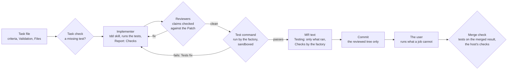

# Testing: how the tests a change brings are guaranteed

No single step guarantees that a change is tested. A chain of checks does, built so that what a
model could get wrong or merely claim is checked by a step it cannot talk its way past: the
reviewers check the Report against the Patch, the factory runs the tests itself, writes the test
result into the MR text itself, and commits only what was reviewed. This page goes
along that chain, says for each step whether a model, the code or a person enforces it, and ends
with the limits. The examples use the workspace `product-frontend` and the ticket `ABC-12`.

## The chain at a glance

| Step | The check | Enforced by | Where it lives |
| --- | --- | --- | --- |
| 1. The plan | Acceptance criteria, a `Validation` section that names the test proving each one, the tests in the Files list | the planner | [ANATOMY.md](../../factory/skills/planning-tasks/ANATOMY.md), [Handbook: Task file format](../../factory/HANDBOOK.md#task-file-format) |
| 2. The Task check | A `missing` test or criterion is a finding; a blocker or major makes the plan `not_ready`, and the run queue waits for `ready` | a model; the queue's wait is code | `src/task-check.ts`, `src/queue-plan.ts` |
| 3. The Implementer | Test first with the `tdd` skill; the tests of the changed files while working and the full suite once before the Report; each command and its result in the Report's `## Checks` | instructions to a model | the user's `tdd` skill, `FACTORY_PROMPT_RULES` in `src/prompts.ts`, [the Report template](../../factory/HANDBOOK.md#report-template) |
| 4. The reviewers | The Report's claims are checked against the Patch; a Task requirement not met is a major item; a contest needs evidence the factory finds | models; the ledger is code | [review rules](../../factory/HANDBOOK.md#review-rules), `src/ledger.ts` |
| 5. The test command | The workspace's `test_command`, run by the factory on the reviewed worktree in its own sandbox; a failure is a Tests fix | code | `src/test-command.ts`, `src/execution/test-step.ts` |
| 6. The MR text | `## Testing` lists only what ran; the factory writes the test result under `### Checks` itself; a manual check claimed as run is refused | code | `src/rules.ts`, `src/mr.ts` |
| 7. The commit | Only the tree the reviewers saw and the tests ran on is committed | code | `commitAndRebase`, `src/mr.ts` |
| 8. The user | Reviews in the IDE, runs what a job cannot, and alone decides the push and the merge | a person | [Review and merge](../guide/review-and-merge.md) |
| 9. The merge | The tests run again on the change merged into the base as it is now; the host's required checks must pass | code, and the host | `src/merge-check.ts`, `src/forge.ts` |

## 1. The plan names the tests

The Task file is the Implementer's whole instruction, so the tests are decided there. The
Handbook's slicing rules put tests in the slice of the code they test, never in a slice of their
own (a test that pins today's behaviour before a refactoring aside:
[Slicing a solution](../../factory/HANDBOOK.md#slicing-a-solution)), and the Task's `## Files`
list names every file the ticket changes, tests included. The Claude Code planner's skill goes
further: every slice carries acceptance criteria
with ids, each observable by a user or a test, and a `Validation` section with the test that proves
each criterion, at the level the repository's rules assign, and the commands to run. Removing a
test, or narrowing what one covers, is the user's choice to make first; one the planner takes
without asking is listed under "Decisions taken without asking"
([ANATOMY.md](../../factory/skills/planning-tasks/ANATOMY.md)).

## 2. The Task check looks for the missing test

Before Start, a fresh reader with the repository open paraphrases the Task and lists what an
Implementer would have to decide alone, among them a `missing` file, test or criterion
([Handbook: Quick start](../../factory/HANDBOOK.md#quick-start), step 4). A blocker or major
finding makes the check `not_ready`, and the run queue starts a ticket only once its check is
`ready` or not needed (`src/queue-plan.ts`). A start by hand does not wait: the check only
advises.

## 3. The Implementer tests first and reports what it ran

`/implement` runs the user's installed `implement` skill, with the `tdd` skill among the
Implementer's skills by default (`DEFAULT_ROLES`, `src/skill-roles.ts`): the red/green discipline
lives in that skill, which the factory copies verbatim and does not ship. On top, every prompt
carries the factory's rules (`FACTORY_PROMPT_RULES`, `src/prompts.ts`): run the tests of the files
you change while working, run the repository's full test suite once before the Report, run every
command in the foreground and wait for it. The Report's `## Checks` lists each command run with its
result, or "not run" and why ([Report template](../../factory/HANDBOOK.md#report-template)).

The factory publishes the Report as written, with the changed files and the denied tool calls
appended. It does not believe it: the next two steps check it.

## 4. The reviewers check the claims against the Patch

The review rules, sent to both reviewers with every iteration, say it outright: "The Report says
what was checked; verify claims against the Patch, do not trust them"
([Review rules](../../factory/HANDBOOK.md#review-rules)). A Task requirement not met is at least a
`major` item, a change that breaks the Task's acceptance a `blocker`, and a verdict must list every
blocker and major item the Patch has, not the first one found. With the `code-review` method, each
item is on the Spec axis (does the change do what the Task asked) or the Standards axis (does it
follow the repository's rules). By default the reviewer is the Codex gate, a model of another
vendor than the Implementer's; on a ticket with `review: claude` a fresh Claude session reviews
the same iteration in the same round.

When the Implementer contests an item, the factory looks for the evidence before it counts the
contest: a `path:line` within the file, a test file or a quoted test name that a test file of the
worktree holds, a `§section` of the Task file, or a quote the user's own message holds
(`findEvidence`, `src/ledger.ts`). "The test covers it" without such evidence leaves the item
open.

## 5. The factory runs the tests itself

A workspace may set a `test_command` in `workspaces.json`
([Configuration](../guide/configuration.md#the-workspace-registry-workspacesjson)). After a clean
round and before the MR text, the factory runs it itself on the reviewed worktree
(`src/execution/test-step.ts`), in a bubblewrap sandbox it builds: the file system read-only, the
denied paths hidden, only the worktree and a private `/tmp` writable, no network but its own
loopback, a short environment with `CI=1`, a timeout (`SF_TEST_TIMEOUT_MS`, 30 minutes by default)
(`src/test-command.ts`; [trust model](../guide/trust-model.md#the-workspaces-test-command)).

- **A failure is a fix round.** A non-zero exit or a timeout becomes `## Fix N: Tests` with the
  command and the end of its output; the fixed iteration is reviewed again before the tests run
  again. After two Tests fixes the job stops (`tests_failed`). A Tests fix does not count toward
  `SF_MAX_ITERATIONS`.
- **No sandbox, no run.** Without `bwrap`, or when the command is not found or not executable
  (exit 127 or 126), the job stops with `tests_unavailable`; there is no fallback outside the
  sandbox.
- **The run cannot change what it is testing in secret.** A run that changes the worktree's `.git`
  or agent configuration fails; a run that changes a file of the change sends the change back to
  review (step 7).
- **The record is the factory's.** Each run is stored as `tests-<N>.json` in the job's directory,
  with the command, the outcome and the output (its last 64 KiB and, when that is not all of it,
  its first 8 KiB).

In the factory's own workspace the test command runs the typecheck and the unit tests
([SECURITY.md](../SECURITY.md)).

## 6. The MR text says only what ran

The MR template's `## Testing` lists "Only what was run in this job, each check with its result";
anything not run (manual steps, live checks, browsers) goes on a line that starts with
`Not checked:` and says who can run it ([MR template](../../factory/HANDBOOK.md#mr-template)). The
factory holds the text to it in three ways:

- **The factory writes the one test result it vouches for.** Under `## Testing` it adds
  `### Checks` from its own record: the command, passed or failed, and on which iteration; and when
  the user accepted failing tests, "accepted by the user without passing tests". It replaces any
  `### Checks` the model wrote (`checksLine`, `src/test-command.ts`; `withChecks`, `src/mr.ts`).
- **A manual check claimed as run is refused.** A `## Testing` line that starts (after any list
  marker, checkbox or emphasis) with "By hand" or "Manual" must also contain "not"; otherwise the
  MR text is invalid (`MANUAL_CLAIM`, `testingProblem`, `src/rules.ts`), the job stops with
  `mr_text_invalid`, and the Merge request screen applies the same rule as the user types.
- **The required headings and the title rule** are checked the same way (`mrTextProblem`,
  `src/mr.ts`), and the push must carry exactly the prepared commit's message.

## 7. What is committed is what was reviewed and tested

Every published iteration records `commit_tree`, the tree the factory's commit would have
(`worktreeTree`, `src/guard.ts`). At MR preparation the factory stages the worktree's change in a
temporary index and commits it only when its tree is that one. When the test run, the MR text turn
or anything else changed a file of the change after the review, nothing is committed: the worktree
goes back to review as a new iteration whose Report names the changed paths; the second time in
a row, the job stops for the user (`unreviewed_change`; `commitAndRebase`, `src/mr.ts`). So the
commit holds the files the reviewers read and the test command ran on, nothing else.

## 8. The user, and what a job cannot run

A job's commands reach only the npm registry and the hosts of `SF_SANDBOX_DOMAINS`, and the test
command has no network but its own loopback, so a check that needs the product's running backend
or real data does not run inside a job. Those checks belong to the user: by default the finished job
is handed over to the user's checkout, where they run, debug and test it, and the MR text's
`Not checked:` lines say what is left and who can run it. The coordinator's follower runs the
changed end-to-end specs against the local backend once a job of a product workspace is handed
over, a flaky one three times ([runbook](../runbooks/coordinator.md#running-tickets)). Nothing is
pushed, opened or merged without the user's command.

## 9. The merge tests the merged result

`sf mr merge` (and the dashboard's Merge), in a workspace with a test command, fetches the base and
the branch, merges them in a temporary detached worktree and runs the tests there, in the same
sandbox (`src/merge-check.ts`). A conflict, a failure, a timeout or a run that cannot happen
refuses the merge (`mr_check_failed`); a base that moves during a passing run is checked once more.
The merge itself then goes through the host's API, which refuses a draft, a conflict, failing
required checks or missing approvals (`mr_not_mergeable`, `src/forge.ts`), so a product's own CI
keeps its say. `sf mr status` shows the checks or the pipeline before you merge.

## How the factory tests itself

- **`npm test`** (`factory/package.json`) runs `check-code`, the build and the unit tests: each
  test file in its own `node --test` process, half the cores at once, at nice 10
  (`src/run-tests.ts`). They need no model and no network: the end-to-end flows drive real `sf`
  processes against local repositories, with a fake Claude Code and a fake Codex
  (`factory/test/support/`) and test hooks that stand in for a reviewer's verdict
  (`src/test-hooks.ts`, on only with `SF_TEST_HOOKS=on`). Some tests pin the code's structure:
  `transitions.test.ts` keeps the reference's job states table equal to `JOB_TRANSITIONS`,
  `architecture.test.ts` keeps the job lifecycle from importing the modules above it,
  `git.test.ts` keeps every Git process in `src/git.ts`. `check-code` fails a module past its size
  limit, a comment that cites a ticket number, and a bare `catch {` without its reason
  ([Handbook](../../factory/HANDBOOK.md#task-file-format), the paragraphs after the format).
- **The browser tests** open the dashboard in a real Chromium through Playwright
  (`npm run test:browser`); they are not part of `npm test`.
- **No hosted CI.** The repository has no CI configuration. Its gates are the test command before
  each merge request, the merge check before each merge, `sf update`'s build, typecheck and
  `sf smoke`, and, by the runbook, the coordinator's full `npm test` of `main` after each update; a
  failure there holds the queue ([runbook](../runbooks/coordinator.md#running-tickets)).

## The live smoke test

The unit tests use fakes for Claude Code and Codex; `sf smoke` (`src/live-smoke.ts`) runs one tiny
real job against the real Claude Code, the real Codex CLI and real Git, in a throwaway repository
with a local bare remote, through the factory's own CLI and HTTP: Setup, Task check, Start, the
Implementer's turn, Sandbox, Gate sandbox, Claude review, Codex gate, MR text, Approve, Dashboard,
Cleanup. Each step passes on what the factory wrote, not on what a model said. Its Sandbox and Gate
sandbox steps probe the denials with canaries ([Security](security.md#how-it-is-checked)). It runs
after every install update (`sf update`), so a new Claude Code or Codex release that changes
something the fakes cannot show fails there
([factory/README.md: Live smoke test](../../factory/README.md#live-smoke-test)).

## Limits

- **The order of red and green is not checked.** The factory sees the final Patch, not whether a
  test failed before its code existed; the `tdd` skill asks for it, and the reviewers see only the
  result.
- **The test command runs only where it is set.** In a workspace without one, the evidence that
  the tests pass is the Implementer's Report, the reviewers' reading of the Patch and, at the
  merge, the host's own checks ([SECURITY.md](../SECURITY.md#open)).
- **Tests and code come from the same agent.** They test what it understood; the Task's
  Validation, the Task check and the reviewers are the counterweight, not a proof.
- **The manual-claim rule is narrow.** It refuses the phrasing that most often breaks the rule; a
  line that claims an un-run check in other words passes it, and only the reviewers and the user
  catch it.
- **The rebase is not tested until the merge.** The test command runs before the rebase onto the
  target; a clean rebase is not tested again, and the merge check, where there is a test command,
  tests the merged result. A merge done on the host outside the factory skips the merge check.
- **Flaky tests.** A flaky failure of the test command is a Tests fix, and at the merge check a
  refusal; nothing reruns it by itself. The factory's own test runner gives up to three failed files
  one more run and says which passed only then (`MAX_RETRIED_FILES`, `src/run-tests.ts`).
- **The user can accept over a stop.** Accept takes a job on to the merge request over failing
  tests, a stopped gate or a ledger stop; the MR text then says so, so the reviewer of the merge
  request sees it.

Back to the [index](README.md).
