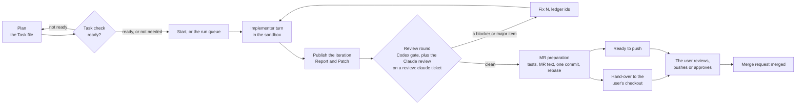
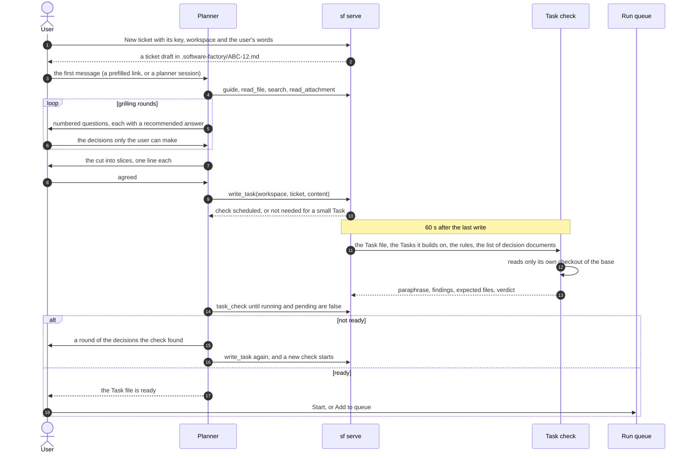
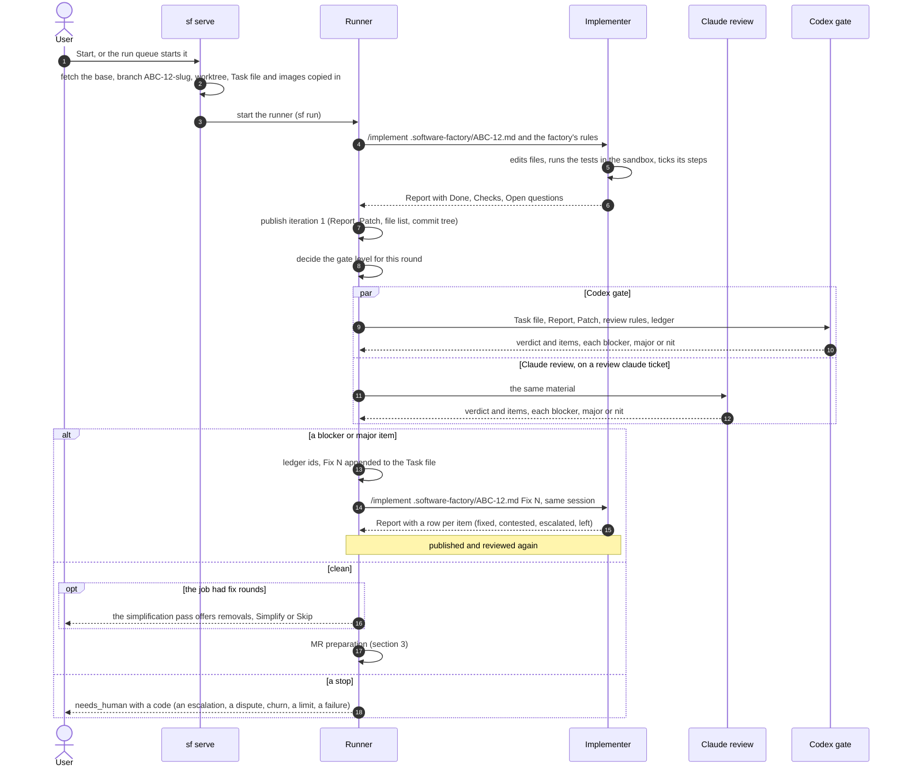
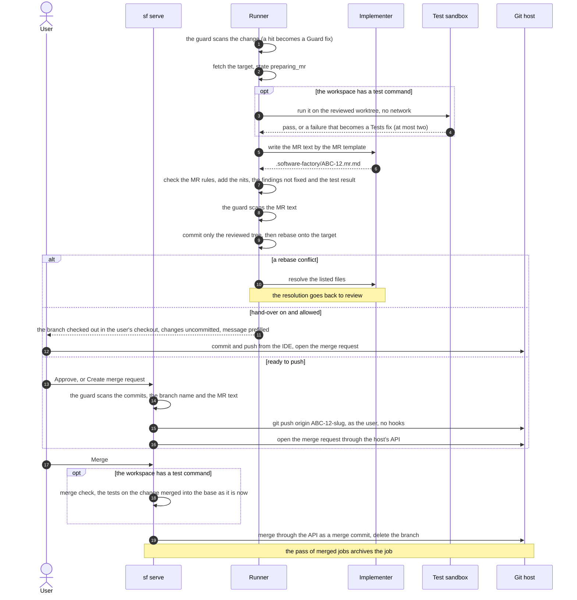
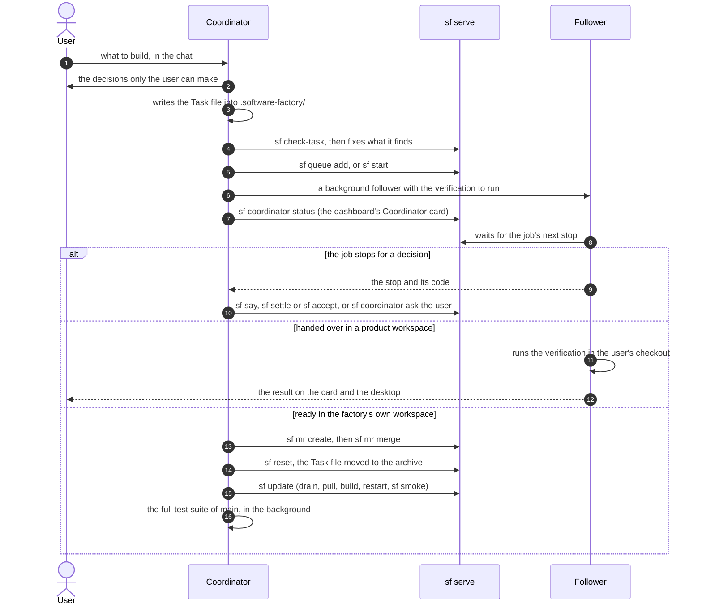

# Workflows

How a ticket travels from an idea to a merged change, step by step, and how the coordinating
session drives the factory. The examples use the workspace `product-frontend` and the ticket
`ABC-12`. The user's side of the same story is in the guide:
[Planning](../guide/planning.md), [Running jobs](../guide/running-jobs.md),
[Review and merge](../guide/review-and-merge.md).

## A ticket's life at a glance

Any step can stop the job for the user (`needs_human`, with a code): a question, a limit, a failure.
The [job lifecycle](job-lifecycle.md) has every state and the step that moves a job between them.

## 1. Planning and the Task check

The planner (the Context owner: ChatGPT through the tunnel, a Claude Code planner in a planning
copy, any MCP client, or a person) only plans. It reads the repository through the factory's
planning tools, grills the user, cuts the work into slices and writes one Task file per slice. The
Task file is the whole contract: the Implementer and the reviewers know only what it says, and its
`## Review brief` carries what the reviewers must check and why
([Handbook: Quick start](../../factory/HANDBOOK.md#quick-start)).

- **The tools.** `guide` returns the Handbook; `read_file` and `search` read the workspace's checkout
  (ignored and credential-like files refused, `src/repo-files.ts`, `src/search.ts`); `write_task`
  writes the Task file, refused while a job of the ticket runs (`src/server.ts`). No tool starts,
  reviews, approves or pushes a job.
- **The Task check** (`src/task-check.ts`) is a fresh read-only Claude session in a temporary
  detached worktree at the Task's base (or at the prepared commit of the ticket it builds on). It
  sees the Task file, its images, the Task files it builds on, the coding rules and the list of
  decision documents, never the planner's conversation, the jobs or the ledger. It paraphrases the
  Task, then lists findings: a `decision` left to the Implementer, a `contradiction` with the code
  or a decision document, something `missing` (a file, a test, a criterion), an `overreach`. It is
  `ready` without a blocker or major finding. It runs by itself 60 s after the last write, unless
  the Task is small (up to 10 `scope:` paths without globs, at most 1,200 words, no `lands_after`
  of another workspace) or says `check: skip` (`src/task-check-auto.ts`); the dashboard's Check
  and `sf check-task` run one in any case.
- **The Claude Code planner's method** is the `planning-tasks` skill the factory ships
  ([SKILL.md](../../factory/skills/planning-tasks/SKILL.md)): ground, grill, prototype the parts
  the user will see, cut, trace each slice through the code with a sub-agent, write, and fix what
  the check finds until it is green. Its Task files carry acceptance criteria with ids and a
  `Validation` section that names the test proving each criterion
  ([ANATOMY.md](../../factory/skills/planning-tasks/ANATOMY.md)).

## 2. Implementation and the review rounds

- **Start** (`src/execution/start.ts`): the factory fetches `origin <base>`, creates the branch
  `ABC-12-<slug>` and its worktree under the state directory, copies the Task file and its images
  in, collects the coding rules (`src/rules-docs.ts`: `AGENTS.md` and the files it links to, and the
  user's rules files) and starts the runner. A start by hand always goes; the queue's conditions
  are below.
- **A turn** (`src/execution/turns.ts`, `src/session.ts`): the first runs
  `/implement .software-factory/ABC-12.md`, each later one `… Fix N`, in the same session. Every
  prompt ends with the factory's rules (`FACTORY_PROMPT_RULES`, `src/prompts.ts`): no Git, no edits
  to the Task file, changes through Edit and Write only, the tests of the changed files while
  working and the full suite once before the Report, commands in the foreground, the Report
  template, never ask the user.
- **Publish**: when the session is idle the factory writes the iteration: the Report (with the
  changed files, the sensitive and out-of-scope paths first, and the denied tool calls), the Patch
  (the uncommitted difference to the base, without ignored, credential-like and
  `.software-factory/` paths, `src/patch.ts`) and `commit_tree`, the tree the factory's commit
  would have.
- **The round** (`src/round.ts`, `src/execution/reviews.ts`): who reviews is decided once, at
  Start. By default the Codex gate alone, at level `full` on every iteration. A Task file that says
  `review: claude` adds a fresh read-only Claude review in the same round, at the same time; the
  gate level then follows the risk of the job's whole change (`src/gate-level.ts`: `full` for a
  sensitive or `may_touch` path, a security-relevant or agent instruction file or a large change,
  `none` for documentation only, `light` otherwise: the gate runs until it first asks for a fix).
  An iteration is clean only when every verdict of the round is.
- **Severity decides, not the reviewer.** Only blocker and major items make a fix; a `fix` with
  nits only counts as clean, and the nits go into the MR text. Items of both reviewers make one
  `## Fix N`, an item both raised is one item, and each gets a ledger id (`src/ledger.ts`).
- **The ledger ends the loop.** The Implementer answers each item by its id: `fixed`, `contested`
  with evidence the factory can find (a `path:line` within the file, a test name in a test file, a
  `§section` of the Task file, the user's own words to the job: `findEvidence`), `escalated` (a
  question only the user can answer: the job stops before the review) or `left` (nits only). The
  reviewers see every settled finding and may reopen one only with evidence; the factory, not the
  reviewer, applies the ledger: a reopened contest is a dispute for the user, a fix reopened twice
  or a round whose every blocking item was caused by earlier fixes is churn. The round limits count
  only rounds without progress
  ([ADR 0005](../adr/0005-api-reviewers-and-factory-git.md), amendments SF-052 and SF-292).
- **The simplification pass** (`src/simplify.ts`): after a clean round of a job that had fix
  rounds, one read-only session names what the fixes added that the Task does not need, never what
  a fixed blocker needed. Simplify writes one more Fix section, reviewed as usual; Skip lists the
  suggestions in the MR text.

## 3. MR preparation, hand-over or push, merge

- **Before anything is committed** (`prepareMr`, `src/execution/mr-steps.ts`): every undeclared
  sensitive path must have been accepted by the reviewers with a reason
  (`sensitive_unacknowledged` otherwise), and the guard scans the change as the factory would
  commit it (`src/guard.ts`). A hit becomes a Fix section `Guard`, at most twice, then a stop.
- **The test command** (`src/test-command.ts`, `src/execution/test-step.ts`): a workspace's
  `test_command` runs in a bubblewrap sandbox the factory builds, without network. A failure
  becomes a `## Fix N: Tests` with the command and the end of its output, at most twice per job;
  then the job stops (`tests_failed`). See [Testing](testing.md).
- **The MR text** is written by the Implementer, checked by the factory (`mrTextProblem`,
  `src/mr.ts`: the title rule, the required headings, no manual check claimed as run), and
  completed by the factory: `### Nits not applied`, `### Review findings not fixed`, and under
  `## Testing` a `### Checks` line from its own test record.
- **What is committed is what the reviewers saw.** The factory stages the worktree's change in a
  temporary index and commits it only when its tree equals the `commit_tree` the reviewed
  iteration recorded; otherwise nothing is committed and the worktree goes back to review as a new
  iteration (`commitAndRebase`, `src/mr.ts`). One commit, with the MR text as its message, rebased
  onto the target so the merge request can be fast-forwarded.
- **The hand-over** (`src/handoff.ts`, `src/execution/handover-steps.ts`) is on by default for a
  workspace (`handoff` in `workspaces.json`, `SF_HANDOFF`): the job's branch is checked out in the
  user's checkout at its base, its changes uncommitted, the commit message prefilled through
  `commit.template`. It never overwrites the user's work (`checkout_dirty`, `checkout_busy`), and
  an automatic hand-over skips a change to files the IDE or tools run by themselves
  (`handoff_sensitive`, `src/handoff-sensitive.ts`).
- **The push and the merge request** happen only on the user's command: Approve pushes
  `origin <branch>` and nothing else, never to `main`, `master` or the base; Create merge request
  opens it on GitHub or GitLab with the MR text; Merge merges through the host's API, as a merge
  commit, never by a push (`src/forge.ts`). Before the merge, a workspace with a test command runs
  its tests on the change merged into the base as it is now (`src/merge-check.ts`).
- **Afterwards** `sf serve` looks at every pushed and handed-over job every 10 minutes and
  archives the ones it finds merged, with only `GET` requests to the host and a fetch of the base
  (`src/execution/archive.ts`).

## The run queue

The queue (`src/queue.ts`) is one ordered list over every workspace. `sf serve` starts the first
queued ticket by itself when fewer than `max_running` jobs run (default `SF_MAX_JOBS`, 3), its Task
check is `ready` or the Task needs none (or the user pressed Start anyway), every `lands_after`
ticket is merged, its `builds_on` ticket has a prepared commit or is merged, and the queue is not
held (by the user, or by a job parked on a usage limit). It never starts a ticket twice. A start by
hand always goes. Parts that build on each other (`builds_on`) are built in a row and submitted
one at a time: the factory refuses to push a part before the part it builds on is merged, then
moves it onto the base by itself (`src/builds-on.ts`).

## The coordinator's loop

The factory develops itself with a coordinating Claude Code session in the user's terminal. Its
rules are the user's, kept in [the coordinator runbook](../runbooks/coordinator.md); the guide
describes the setup ([Ways of working](../guide/ways-of-working.md#3-with-a-coordinating-claude-code-session)).

- One ticket is one factory job (or, for work the factory cannot do, one fresh subagent): every
  ticket starts with a clean context. The coordinator waits with background watchers, not by
  polling.
- Before delegating, the whole design goes into the Task file; decisions the user must make are
  asked first. Product tickets carry `check: required`.
- In a product repository the coordinator never approves, pushes or opens a merge request without
  the user's explicit go. Never to `main`, in any repository.
- The coordinator reports on the dashboard (`sf coordinator status`, `ask`, `answered`, `link`;
  `src/coordinator.ts`), so the user can follow from the phone.

## Where a person decides

The factory moves a job by itself between the user's decisions and never takes one for them:

- the plan's decisions, in the grilling rounds;
- Start (or the queue, which the user fills and orders);
- each stop: the stops table (`src/stops.ts`) has a row per stop code, 31 of them (aliases
  aside): 11 decisions (an escalation, a dispute, churn, a round limit, the gate's budget, the
  simplification offer, tests that keep failing, …) and 20 errors, each with the actions it
  offers;
- Accept over a stopped gate, a ledger stop or failing tests, which the MR text records;
- the hand-over, Ask for changes, Take it back;
- Approve (the push), Create merge request, Merge.

The factory never acts on a model's claim of the user's approval that the user did not give in
the terminal or on the dashboard ([Handbook](../../factory/HANDBOOK.md#what-the-factory-never-does)).

## Trade-offs

- **The planner is not there at review time.** The Review brief replaces it, so a Task file that
  leaves a decision open shows up as a finding late; the Task check exists to find it early.
- **Every round is a fresh reviewer**, so each samples new items: the ledger, the progress rule and
  the churn stop keep that from becoming an endless loop, at the price of a stop the user answers.
- **The Codex gate alone by default.** The Claude review is kept for risky tickets
  (`review: claude`): in the audit of 2026-11-07 the gate had raised 94 blocker or major items (58
  fixed), the Claude review 20 (6 fixed) at 18% of the cost
  ([ADR 0005](../adr/0005-api-reviewers-and-factory-git.md), amendment SF-131).
- **The hand-over switches the user's checkout.** Workspaces driven by a coordinator turn it off
  (`handoff: off`) and go through `sf mr create` and `sf mr merge`.

Next: [Job lifecycle](job-lifecycle.md).
