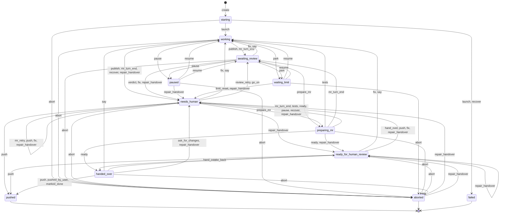

# Concepts

This page explains, in plain words, how a ticket travels from an idea to a merged change, the words
the factory uses for each part, and every state a job can be in.

The exact definitions are in [CONTEXT.md](../../CONTEXT.md); this page uses the same words and
says where the dashboard shows a different label.

## From idea to merged change

1. **You have an idea or a ticket** (for example `APP-12` in Jira) for a repository you registered
   as a **workspace** (`my-app`, the checkout at `~/work/my-app`).
2. **You plan it into a Task file**: `.software-factory/APP-12.md` in that checkout, ignored by Git.
   It says what to build, which files change, what is out of scope and what the reviewers must check
   (the `## Review brief`). You can plan with ChatGPT, with Claude Code, by hand, or start from the
   dashboard's New ticket ([Planning](planning.md)).
3. **The Task check reads the plan** before anything is built: a fresh read-only Claude session sees
   only the Task file, the Tasks it builds on and the repository, says in its own words what the
   Task asks, and lists what is missing, contradictory or left undecided. It only advises.
4. **You start the job**, or put the ticket in the **queue**, which starts it when a slot is free,
   its plan check is `ready` (or the Task needs none) and what it waits for is done: its
   `lands_after` tickets merged, its `builds_on` ticket prepared or merged.
5. **The Implementer works**: Claude Code, headless, in a Git worktree of its own on a new branch
   `APP-12-<slug>`, never in your checkout. Its first turn runs `/implement .software-factory/APP-12.md`.
   When it stops, the factory publishes an **iteration**: its Report and the Patch (the uncommitted
   difference to the base).
6. **The reviewers review the iteration**: by default the **Codex gate** alone (the Codex CLI on
   your ChatGPT plan). A ticket whose Task file says `review: claude` (with
   `SF_CLAUDE_REVIEW=always`, every ticket but those that say `review: codex`) also gets a fresh
   read-only Claude session (the **Claude review**): when the gate level runs the gate, both
   review it in the same round, at the same time (the **joint round**); otherwise the Claude
   review reviews alone. With the gate off, the Claude review reviews every ticket alone. A verdict
   with a blocker or major finding makes one `## Fix N` section appended to the Task file (in a
   joint round with the findings of both, each naming who raised it), and the next iteration
   starts by itself. Every finding gets an id in the **ledger** (`R1`, `R2`, …) so it is never
   argued twice.
7. **Clean**: when the round's reviews (in a joint round, both) have no blocker or major finding,
   the factory may offer you a
   **simplification pass** (only after fix rounds), then runs **MR preparation**: the Implementer
   writes the **MR text** (title and description), and the factory commits the change as one commit
   with that text as the message and rebases it onto the base branch.
8. **The result comes to you**: by default the factory **hands it over** to your checkout: the
   job's branch checked out, its changes as uncommitted Local Changes, the commit message prefilled.
   Or it waits in `ready_for_human_review`, and you push and open the merge request from the
   dashboard.
9. **You review and finish**: commit and push from the IDE, or Approve (the factory pushes), or ask
   the Implementer for changes; optionally the factory opens and merges the merge request on GitHub
   or GitLab. The job ends `pushed`.

At any point the job may **stop for you** (`needs_human`) with a code saying why: a question, a
limit, a failure. [When a job stops](when-a-job-stops.md) lists them all.

```
plan ─► Task file ─► Task check ─► Start / queue ─► iteration ─► Codex gate (+ Claude review) ─► Clean
                                                       ▲                      │                      │
                                                       └─────── Fix N ◄───────┘                      ▼
                                                                    MR preparation ─► hand-over or push ─► merge
```

## Vocabulary

| Term (code, `CONTEXT.md`) | Dashboard label | What it is |
| --- | --- | --- |
| **Workspace** | Workspaces | A registered repository: a name and the path of your local checkout (the one open in your IDE). Task files live in it; every job's worktree is created from it. |
| **Task file** | Task | `.software-factory/<ticket>.md` in the workspace's checkout: front matter, the task, the `## Review brief`, and the `## Fix N` sections the factory appends. The complete instruction for the Implementer and the brief for the reviewers. |
| **Ticket draft** (skeleton) | `draft` | A Task file written by New ticket before anyone planned it: front matter and a status line. It cannot be started or queued. |
| **Context owner** | Context owner, Plan with (ChatGPT or Claude Code) | The model you plan with. It only plans: reads the repository, writes the Task file. It never starts, reviews or approves. |
| **Task check** (`sf check-task`) | Check, Check the plan, Plan check | A fresh read-only Claude session that reads the Task file, the Tasks it builds on and the repository before Start and gives `ready`, `not_ready` or `failed`, with findings. Only advises; the queue waits for `ready`. |
| **Queue** (`sf queue`) | the Queue column, "Run up to N jobs at once" | One ordered list of planned tickets over all workspaces and the limit `max_running`; `sf serve` starts the next one by itself when a slot is free. |
| **Job** | a card in Implementing, Reviewing, Your turn or Done | One ticket being implemented on one branch. Its state is one of the states below. |
| **Runner** (`sf run`) | | The process of one job, detached from `sf serve`, so restarting `sf serve` leaves the job running. |
| **Worktree** | | The job's own Git worktree under the factory's state directory, where the Implementer works. |
| **Implementer** | Implementer | The Claude Code session (Agent SDK, headless, sandboxed) that executes the Task file. |
| **Iteration** | Iteration N | One run of one section of the Task file: the task first, then each Fix section. It produces a Report and a Patch. |
| **Report** | Report | The Implementer's account of an iteration: what was done, the checks run, open questions, an answer per Fix item. |
| **Claude review** | Claude review | A fresh read-only Claude session that reviews each iteration against the Task file, the rules and the ledger. |
| **Codex gate** | Codex gate | The review by the Codex CLI: in the same round as the Claude review, at the same time, or alone on a job without it. On a job with the Claude review, its **gate level** (`full`, `light`, `none`) decides how much of it an iteration gets; alone, it reviews every iteration. |
| **Joint round** | | The review of an iteration by the Claude review and the Codex gate at the same time; their findings make one Fix section, and the iteration is clean only when both verdicts are. |
| **Fix section** | Fix N | `## Fix N`, appended by the factory from a verdict with a blocker or major item; it starts the next iteration. |
| **Severity** | blocker, major, nit | The weight of a finding. Only blockers and majors make a fix; nits never block and go into the MR text. |
| **Ledger** | findings, R7 | `ledger.json`: every finding that went into a Fix section, with an id and its status (open, fixed, contested, escalated, left, accepted risk, must fix). |
| **Clean** | "Reviews are clean" | The round's verdict that no further fix is needed (in a joint round, both reviews'). It starts MR preparation. |
| **Simplification pass** | Simplification offered, Simplify or skip | After a job with fix rounds: one read-only session that names what the fixes added that the Task does not need. You choose Simplify or Skip. |
| **MR preparation** | Now: MR writer | The Implementer writes the MR text; the factory commits (one commit) and rebases. |
| **MR text** | Merge request | `.software-factory/<ticket>.mr.md`, then `mr.md` of the job: the title (also the commit header) and the description by the MR template. Editable on the Merge request screen before the push. |
| **Hand-over** | Hand over to my checkout, In your checkout on `<branch>` | The job's branch checked out in your checkout, its changes uncommitted, the commit message prefilled. |
| **Approve** (`sf approve`) | Approve, Push branch only | The push of the branch prepared at Clean. |
| **Rules** (coding rules) | | `AGENTS.md` (and the Markdown files it links to) in the repository plus your own `rules/<workspace>.md` and `rules/global.md`, handed to the Implementer, the reviewers and the Task check ([Configuration](configuration.md#coding-rules)). |
| **Handbook** | | [factory/HANDBOOK.md](../../factory/HANDBOOK.md): what the Context owner is told, including the Task file format, the review rules and the Git rules. |

## The job states

A job's allowed state changes are the table `JOB_TRANSITIONS` in `factory/src/jobs.ts`; the
reference prints it in full ([Job states](../../factory/README.md#job-states)), and a test keeps the
two the same. The diagram below draws every state change of that table once, labelled with the
steps that make it.



`repair_handover` is the repair of a hand-over that was cut off (by a crash or a restart of
`sf serve`); `recover` is what `sf serve` does at its start with a job whose runner is gone. You
never trigger either directly.

`failed`, `aborted` and `pushed` are terminal: a new job of the ticket may start after them. The
**running** states, which count against the queue's limit, are `starting`, `working`,
`awaiting_review`, `preparing_mr` and `waiting_limit` (`RUNNING_STATES`). A paused job and a job
that waits for you do not count.

| State | What it means | Who acts next | Buttons (job page) and commands |
| --- | --- | --- | --- |
| `starting` | The job record exists; the factory fetches the base, creates the worktree and the branch and queues the first turn. | The factory | Abort… (`sf abort`) |
| `working` | The Implementer runs a turn (the task, a Fix section, your message, the MR text or a conflict resolution). | The Implementer | Send (`sf say`: waits as the next turn), Pause (`sf pause`), Abort… (`sf abort`) |
| `awaiting_review` | An iteration is published; the Claude review, the Codex gate or the simplification pass runs on it (or nothing runs, with `SF_REVIEW=off`). | The reviewers | Send (`sf say`: a new turn instead of the verdict), Pause (`sf pause`), Abort… |
| `preparing_mr` | MR preparation: the MR text turn, the commit and the rebase, and a conflict turn when the rebase conflicts. | The Implementer, then the factory | Abort… only (`sf pause` stops it in `needs_human` with `mr_interrupted`) |
| `needs_human` | Stopped for you, with a code (a decision or an error). | You | Depends on the code: Send, Accept and prepare MR (`sf accept`), Accept risk / Must fix (`sf settle`), Retry review (`sf review`), Retry (`sf retry`), Simplify (`sf simplify`), Push again (`sf approve`), Restart… (`sf restart`), Abort…. See [When a job stops](when-a-job-stops.md). |
| `paused` | You paused it; nothing runs; worktree, branch and session stay. | You | Resume (`sf resume [message]`), Restart… (`sf restart`), Abort… |
| `waiting_limit` | A session hit the plan's usage limit; parked until the reset, holding its queue slot. Board label "Waiting for limits". | The queue at the reset, or you | Resume now (`sf resume`), Restart… (`sf restart`), Abort…; `sf say` and `sf pause` are refused |
| `ready_for_human_review` | Clean, MR text written, one commit on the branch; not handed over (hand-over off or refused). Board: "Ready to push". | You | Review the MR and push (the Merge request screen), Approve… (`sf approve [--as-is]`), Hand over to my checkout (`sf handover`), Create merge request (`sf mr create`), Send (`sf say`: a further fix), Abort… |
| `handed_over` | The branch is checked out in your checkout with the changes uncommitted. Board: "In your checkout on `<branch>`". | You | Approve… (`sf approve`), Ask for changes (`sf say`), I opened the MR myself (`sf handed-done`), Merged — archive (`sf handed-done --merged`), Take it back (`sf takeback`), Create merge request (`sf mr create`), Abort… (`sf abort`, without `--discard`) |
| `pushed` | Done: the branch is on `origin` (pushed by the factory or by you), or you pressed Merged — archive on a handed-over job and its Archive step failed (press it again). Terminal. | You (the merge request) | Create merge request (`sf mr create`), Merge… (`sf mr merge`), Refresh MR status (`sf mr status`), Merged — archive (`sf handed-done --merged`: you merged it; the job is archived without the factory asking `origin`), Archive (`sf reset`). `sf serve` archives it by itself when its merge request is merged on the host or its commit is found on the base. |
| `aborted` | Ended by you; the branch (and, without `--discard`, the worktree) stays. Terminal. | You | Restart… (`sf restart`), Archive (`sf reset`) |
| `failed` | The job could not start (for example `rules_failed`, a failed worktree creation). Terminal. | You | Restart… (`sf restart`), Archive (`sf reset`) |

Every command takes `<workspace> <ticket>`, for example `sf say my-app APP-12 "Use the existing
date helper"`. The board's columns group the states: **Queue** (planned tickets, and tickets whose
last job failed or was aborted), **Implementing** (`starting`, `working`, `waiting_limit`),
**Reviewing** (`awaiting_review`, `preparing_mr`), **Your turn** (`needs_human`,
`ready_for_human_review`, `handed_over`, `paused`) and **Done** (`pushed`, and `aborted` or
`failed` when the ticket has no Queue card).

## What the factory never does

It never pushes or commits outside the MR preparation of a Clean, never opens or merges a merge
request without your command, never pushes to `main` or `master`, never reads or exposes your
credentials, and touches your checkout only through its Git refs, worktree registrations and the
hand-over (which never loses a file of yours). The full list is the last section of the
[Handbook](../../factory/HANDBOOK.md#what-the-factory-never-does).

Next: [Install](install.md).
